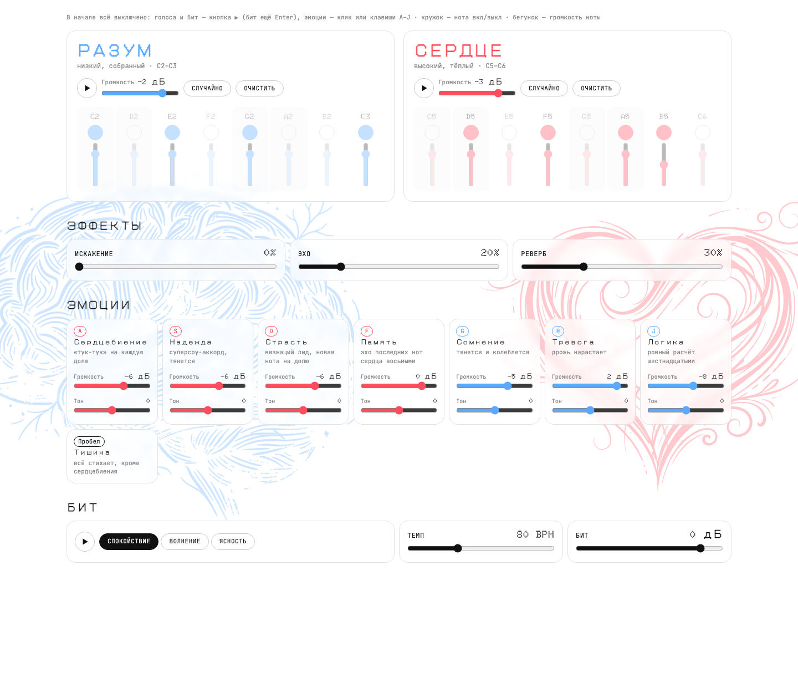
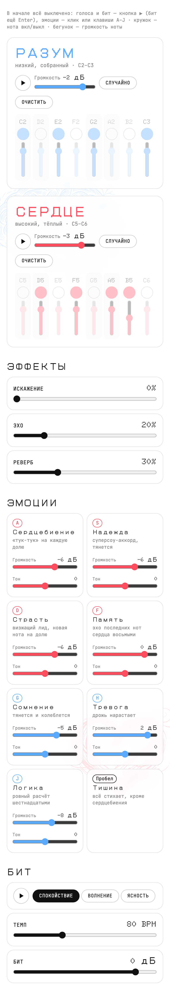

# Разум и Сердце

Веб-синтезатор внутреннего разговора для живого исполнения: низкий Разум и высокое Сердце шагают в одном темпе, а исполнитель включает эмоции, которые их перебивают.

## Ссылки

- Сайт: [1zumink.github.io/heart_synth](https://1zumink.github.io/heart_synth/)
- Макет в Figma: [Разум и Сердце — интерфейс](https://www.figma.com/design/ZLKup92dyFZhm3W0UQi3lH) (страница «Синтезатор» — интерфейс и компоненты)
- Презентация: страница «Презентация» в том же файле Figma
- Скринкаст: [kinescope.io/iPxGYVFrX4BukNoBkKS53e](https://kinescope.io/iPxGYVFrX4BukNoBkKS53e) (запись прототипа)

## Скриншоты





## Команда

| Участник | Что делал |
| --- | --- |
| Илья Ланг | Концепция и музыкальное высказывание; выбор звучания голосов, эмоций и бита и проверка их на слух; постановка задач ИИ и приёмка каждой итерации (откат авторазговора, отказ от зацикленных эмоций, требование вступать ровно в бит); поиск багов в живой игре; светлый редизайн интерфейса; исполнение сета |
| Claude Code (ИИ) | Код синтезатора, отладка, настройка деплоя, перенос дизайна в Figma, сборка презентации — по задачам Ильи, подробно в разделе «Использование ИИ» |

## Стек

- [Tone.js](https://tonejs.github.io/) 15.1.22 — синтезаторы, эффекты, транспорт
- [Bun](https://bun.sh/) 1.4.3 — dev-сервер и сборка
- HTML, CSS, JavaScript без фреймворков
- GitHub Actions + GitHub Pages — сборка и публикация
- Figma — макет, компоненты, презентация

## Как запустить локально

```bash
git clone https://github.com/1zumink/heart_synth.git
cd heart_synth
bun install
bun run dev        # http://localhost:3000, или npm run dev
bun run build      # сборка в dist/
```

Звук включается первым кликом или клавишей: в начале всё выключено. Голоса — кнопкой ▶, бит — ▶ или `Enter`, эмоции — кликом по карточке или клавишами `A S D F G H J`, Тишина — `Пробел`.

## Структура проекта

```
src/
  index.html               — разметка страницы: фон, секвенсор, эффекты, эмоции, бит
  index.js                 — точка входа, запускает sketch после загрузки DOM
  index.css                — подключает все таблицы стилей
  javascript/
    sketch.js              — сборка инструмента: темп, микшер, инструменты, интерфейс, разблокировка звука
    mixer.js               — шины Разума, Сердца и бита, Тишина, мастер (компрессор → лимитер)
    effects.js             — общая стойка: искажение → эхо → реверб и их бегунки
    sequencer.js           — шаговый секвенсор на 8 нот До–До для обоих голосов
    keyboard.js            — эмоции-переключатели: клавиши, пэды, громкость и тон
    conversation.js        — подсветка фона по уровню Разума и Сердца
    utilities.js           — часы для моносинтов, квантизация в бит (nextBeat), паттерны бита
    instruments/           — по файлу на голос, эмоцию и бит: конфиг, цепочка эффектов, start/stop
    ui/controls.js         — бегунки и кнопки (включая круглую ▶)
  stylesheets/             — переменные и стили по компонентам: Step, Pad, Slider, ToggleButton…
  samples/                 — сэмплы драм-машины TR-909
  images/                  — рисунки мозга и сердца для фона
  ai/                      — скриншоты для README
docs/ai-log.md             — подробный журнал работы с ИИ
.github/workflows/         — сборка и публикация на GitHub Pages
```

## Решения и сложности

- **Ошибка «Start time must be strictly greater than previous start time».** Моносинты Tone.js падали, когда два старта попадали в одно время (быстрые нажатия). Сделали часы `createClock` в `utilities.js`: каждое следующее время хотя бы на 5 мс позже предыдущего.
- **Эмоции «уезжали» после нескольких минут игры.** Включение в бит было через строку `'@8n'`, а Tone считает её от времени AudioContext по текущему темпу. После любого движения бегунка темпа ошибка росла с каждой минутой. Заменили на свою функцию `nextBeat()`, которая считает ближайшую долю в тиках транспорта; баг воспроизвели на стенде до и после правки.
- **Эмоции сначала обрывались на каждой доле.** Первая версия «эмоций в бит» перезапускала звук каждую долю. Оставили тянущийся звук, а в бит квантуются только моменты включения и выключения; у Страсти ноты меняются легато через портаменто.
- **Память «долго включалась».** Причина была не в задержке: PluckSynth играл низкие ноты на 10–20 дБ тише. Заменили на ровный чиптюн-щипок, это нашли замером громкости.
- **Браузер не даёт звучать без действия пользователя.** Вместо стартового экрана звук разблокируется первым кликом или клавишей — тем же действием, которое что-то включает.
- **Сознательно не сделали:** запись и экспорт сета, MIDI-контроллер и игру на телефоне с клавиатуры — на сдаче играем вживую в браузере на компьютере.

## Использование ИИ

### Инструменты

| Инструмент и модель | Кто | Для каких задач | Уровень (0–4) |
| --- | --- | --- | --- |
| Claude Code (Claude Opus 5.5) | Илья | Код синтезатора и интерфейса, звуковые цепочки, отладка таймингов, настройка GitHub Pages | 4 |
| Claude Code (Claude Opus 5.5) + Figma MCP | Илья | Перенос светлого дизайна в Figma, компоненты, презентация | 4 |
| Claude Code (Claude Opus 5.5) | Илья | Объяснения устройства Tone.js, тексты описания и README | 3 |
| [уточнить инструмент] | Илья | Рисунки мозга и сердца для фона | 4 |

### Журнал запросов

Подробный журнал из 13 записей — в [docs/ai-log.md](docs/ai-log.md). Кратко:

1. Каркас синтезатора: два голоса, эмоции, каналы, концепция «битвы».
2. Исправление ошибки времени старта у моносинтов.
3. «Не битва, а разговор»: громче Разум, бит Сердца и Разума.
4. Авторазговор голосов — потом отменён.
5. Шаговый секвенсор и общая стойка эффектов с бегунками.
6. Эмоции-переключатели в бит, ноты от До до До.
7. Откат: эмоции не должны обрываться на каждой доле.
8. Мгновенное вступление эмоций, громкость и тон на пэдах, звук «как у Пошлой Молли».
9. Баг: через несколько минут эмоции включаются с задержкой.
10. Без стартового экрана, в начале всё выключено.
11. Публикация на GitHub Pages.
12. Перенос светлого дизайна в Figma.
13. Презентация во фреймах Figma.

### Рефлексия

ИИ хорошо справлялся с кодом и с поиском технических причин багов: задержку эмоций после смены темпа и «тихую» Память я бы сам не нашёл — он воспроизводил баги на стенде и мерил громкость. Хуже всего ИИ понимал музыкальные намерения: «чтобы эмоции шли в бит» он сначала понял как «перезапускать звук каждую долю», и лид начал рваться — пришлось объяснять, что в бит должны попадать только включение и выключение. Авторазговор голосов, который ИИ сделал по моей просьбе, я в итоге выкинул: мне важно управлять каждой нотой самому, иначе это не исполнение. Ошибки я замечал в основном на слух и в живой игре, а не в коде. Я разобрался, как устроены цепочки эффектов, шины и транспорт в Tone.js; планировщик Tone и то, как он считает время, пока остаётся для меня скорее чёрным ящиком. В следующий раз я бы раньше описывал ИИ, как инструмент должен звучать и вести себя в игре, и вёл журнал сразу, а не восстанавливал его в конце.
